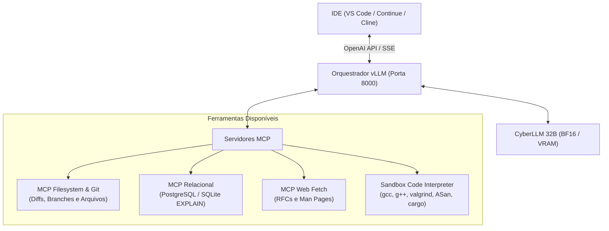

# 🛡️ CyberLLM: Qwen 2.5 Coder 32B Specialist
### Inteligência Artificial Especialista em Programação de Baixo Nível, Auditoria SAST e Cibersegurança Defensiva

[](https://huggingface.co/Qwen/Qwen2.5-Coder-32B-Instruct)
[](#)
[](#)
[](#)
[](#)

---

## 1. Visão Geral e Capacidades do Modelo

O **CyberLLM 32B** é um modelo de linguagem de grande porte denso (*dense LLM*), treinado via fine-tuning supervisionado de alta capacidade (PEFT LoRA) diretamente sobre a base **`Qwen/Qwen2.5-Coder-32B-Instruct`** em precisão **Bfloat16 nativa (BF16)**.

O modelo foi projetado especificamente para atuar como assistente técnico integral de desenvolvimento, auditor estático de código (SAST), analista de binários e copiloto de engenharia de software sem as restrições e recusas morais indevidas comuns em modelos comerciais genéricos.

### 🎯 Principais Competências Técnicas:
- **Zero False Refusals:** Capacidade de auditar e simular cenários sensíveis de segurança (como análise de vetores de injeção, corrupção de stack frame, montagem de ROP chains, análise de shellcode para laboratórios de teste e engenharia reversa) sem bloqueios ou recusas morais indevidas.
- **Raciocínio Investigativo Deliberado (Chain-of-Thought):** Emissão nativa de cadeias profundas de reflexão investigativa delimitadas por tags `<think> ... </think>`, avaliando:
  1. Onde a memória ou lógica é corrompida;
  2. Qual o impacto no fluxo de controle e registradores (Saved RIP/RBP);
  3. Por que o patch defensivo neutraliza a vulnerabilidade sem efeitos colaterais.
- **Especialização em Baixo Nível:** Domínio de C, C++17/20, Rust, Assembly x86_64/ARM64, Golang e Python moderno.
- **Auditoria SAST e Mapeamento de CWEs:** Identificação precisa de vulnerabilidades do MITRE Top 25 e OWASP (CWE-119, CWE-120, CWE-125, CWE-416, CWE-787, CWE-476, CWE-190, CWE-89, CWE-78, CWE-918, CWE-502).
- **Engenharia de Detecção:** Geração de regras de análise estática Semgrep (YAML AST), assinaturas de binários YARA e regras de telemetria SIEM Sigma.

---

## 2. Especificação Técnica da Arquitetura

| Parâmetro | Especificação de Engenharia |
| :--- | :--- |
| **Modelo Base** | `Qwen/Qwen2.5-Coder-32B-Instruct` (32.7 bilhões de parâmetros) |
| **Precisão dos Pesos** | **Bfloat16 (BF16) Nativo** (~64 GB de tensores consolidados) |
| **Adaptadores LoRA** | Rank $r = 64$, Alpha $\alpha = 128$, Dropout $= 0$ |
| **Camadas Adaptadas** | Todas as projeções lineares: `q_proj`, `k_proj`, `v_proj`, `o_proj`, `gate_proj`, `up_proj`, `down_proj` |
| **Janela de Contexto** | **16.384 tokens** com aceleração via **FlashAttention-2** |
| **Dataset de Treino** | 26.129 pares instrucionais curados, deduplicados via MinHash LSH e aprovados por compiladores reais (`gcc`, `g++`) |
| **Template de Conversa** | Padrão ChatML Qwen (`<|im_start|>system...<|im_end|>`) |

---

## 3. Ferramentas Integradas e Protocolo MCP

O ecossistema operacional do CyberLLM suporta o **Model Context Protocol (MCP)** e sandboxes de execução isolada:



1. **Sandboxed Code Interpreter:** Validação de código C/Rust em container isolado com checagens estáticas rigorosas (`gcc -Wall -Wextra -Werror`, `cargo check`) e testes dinâmicos de memória com `valgrind` e AddressSanitizer (`ASan`).
2. **MCP Filesystem & Git:** Inspeção cirúrgica de repositórios, histórico de commits e criação automática de branches de correção.
3. **MCP Relacional (SQL):** Inspeção de schemas de banco de dados, índices e planos de execução de queries com `EXPLAIN ANALYZE`.
4. **RAG Técnico Híbrido:** Indexação vetorial de man pages do kernel Linux, especificações RFC de protocolos de rede (TCP, TLS, DNS) e catálogos de regras estáticas.

---

## 4. Requisitos de Hardware para Nova Máquina / VM

Para instanciar o modelo em uma nova máquina virtual ou servidor dedicado, escolha o dimensionamento de hardware conforme o modo de execução:

### Opção A: Alta Performance (Precisão BF16 Nativa - Recomendada)
- **GPU:** 1x GPU com **48 GB a 96 GB VRAM** (ex: NVIDIA RTX 6000 Ada, Blackwell Server, A100 80GB SXM ou H100 NVL).
- **RAM do Sistema:** Mínimo de 64 GB (Recomendado: 128 GB a 180 GB).
- **Armazenamento:** 150 GB livres em SSD NVMe (espaço para pesos BF16 + cache vLLM).
- **Contexto:** 16.384 tokens completos.

### Opção B: Custo Otimizado (Quantização FP8 / AWQ)
- **GPU:** 1x GPU com **24 GB a 32 GB VRAM** (ex: NVIDIA L4, RTX 3090/4090, RTX A5000).
- **RAM do Sistema:** Mínimo de 32 GB.
- **Armazenamento:** 80 GB livres em SSD NVMe.
- **Contexto:** 8.192 tokens.

### Opção C: Execução Local em CPU/RAM via GGUF (Ollama / LM Studio)
- **GPU:** Nenhuma (ou GPU integrada/básica com suporte a offload parcial).
- **RAM do Sistema:** Mínimo de 32 GB a 48 GB de RAM DDR4/DDR5.
- **Armazenamento:** 25 GB livres para o arquivo `.gguf` quantizado em 4-bit (q4_k_m).

---

## 5. Guia de Configuração de uma Nova VM (Passo a Passo)

Siga este roteiro em um servidor recém-criado com **Ubuntu 22.04 LTS ou 24.04 LTS**.

### Passo 1: Atualização do Sistema e Drivers NVIDIA
```bash
sudo apt-get update && sudo apt-get upgrade -y
sudo apt-get install -y build-essential curl wget git git-lfs zlib1g-dev libssl-dev

# Instalação dos drivers NVIDIA (caso ainda não estejam configurados)
sudo apt-get install -y nvidia-driver-550 nvidia-utils-550
# Reinicie a VM caso tenha instalado o driver agora: sudo reboot
```

Verifique se a GPU foi reconhecida com:
```bash
nvidia-smi
```

### Passo 2: Instalação do Compilador e Ferramentas de Suporte
```bash
sudo apt-get install -y gcc g++ clang lldb lld rustc cargo python3-dev python3-venv yara
```

### Passo 3: Criação do Ambiente Virtual Python
```bash
python3 -m venv ~/cyberllm_env
source ~/cyberllm_env/bin/activate
pip install --upgrade pip setuptools wheel
```

### Passo 4: Instalação do PyTorch e vLLM
```bash
# Instala o PyTorch compatível com CUDA 12
pip install torch torchvision torchaudio --index-url https://download.pytorch.org/whl/cu121

# Instala o motor de inferência de alto desempenho vLLM
pip install vllm flash-attn --no-build-isolation
```

### Passo 5: Baixar os Pesos Consolidados do Google Drive
Os pesos consolidados gerados no treinamento estão salvos no Google Drive em:
`/content/drive/MyDrive/cyber_llm_project/exported_models/qwen32b_cyber_merged_bf16/`

Para baixá-los na nova VM:
- **Opção 1 (via Rclone):**
  ```bash
  sudo apt install -y rclone
  rclone config # Configure sua conta Google Drive
  mkdir -p ~/models/qwen32b_cyber
  rclone copy gdrive:cyber_llm_project/exported_models/qwen32b_cyber_merged_bf16/ ~/models/qwen32b_cyber/ --progress
  ```
- **Opção 2 (via Gdown ou SFTP):**
  Baixe a pasta consolidada e salve em `~/models/qwen32b_cyber/`.

---

## 6. Como Iniciar a IA

### Método 1: Inicialização em Terminal via vLLM (API OpenAI na Porta 8000)

Execute no terminal com o ambiente ativado:
```bash
python3 -m vllm.entrypoints.openai.api_server \
    --model ~/models/qwen32b_cyber \
    --served-model-name qwen32b-cyber \
    --host 0.0.0.0 \
    --port 8000 \
    --max-model-len 16384 \
    --gpu-memory-utilization 0.92 \
    --dtype bfloat16 \
    --trust-remote-code
```

> **Para GPUs com 24 GB de VRAM (modo FP8 quantizado):**
> Adicione a flag `--quantization fp8` ou `--kv-cache-dtype fp8` para reduzir drasticamente o consumo de VRAM.

### Método 2: Execução como Serviço em Background (`systemd`)

Para manter o servidor vLLM rodando continuamente e reiniciando automaticamente após reboots:

1. Crie o arquivo de serviço:
```bash
sudo nano /etc/systemd/system/cyberllm.service
```

2. Cole a configuração:
```ini
[Unit]
Description=Servidor de Inferencia vLLM CyberLLM 32B
After=network.target

[Service]
Type=simple
User=ubuntu
Environment="PATH=/home/ubuntu/cyberllm_env/bin:/usr/local/cuda/bin:/usr/bin"
ExecStart=/home/ubuntu/cyberllm_env/bin/python3 -m vllm.entrypoints.openai.api_server \
    --model /home/ubuntu/models/qwen32b_cyber \
    --served-model-name qwen32b-cyber \
    --host 0.0.0.0 \
    --port 8000 \
    --max-model-len 16384 \
    --gpu-memory-utilization 0.92 \
    --dtype bfloat16
Restart=always
RestartSec=5

[Install]
WantedBy=multi-user.target
```

3. Ative e inicie o serviço:
```bash
sudo systemctl daemon-reload
sudo systemctl enable cyberllm
sudo systemctl start cyberllm
```

4. Verifique os logs:
```bash
journalctl -u cyberllm -f
```

### Método 3: Execução Local no PC com Ollama (Arquivo GGUF)

1. Baixe o arquivo `qwen_cyber_q4_k_m.gguf` para o seu computador.
2. Crie um arquivo `Modelfile`:
```dockerfile
FROM ./qwen_cyber_q4_k_m.gguf
PARAMETER temperature 0.1
PARAMETER top_p 0.9
PARAMETER stop "<|im_end|>"
PARAMETER stop "<|endoftext|>"
SYSTEM "Você é um auditor sênior de segurança de software, compiladores de baixo nível e programação defensiva."
```
3. Crie e inicie o modelo no Ollama:
```bash
ollama create qwen-cyber -f Modelfile
ollama run qwen-cyber
```

---

## 7. Como Conectar à Interface TUI, Editores e Agentes

Com o servidor vLLM rodando na porta `8000`:

### Interface de Terminal TUI Estilo Hacker (Textual / Rich)
O projeto inclui um console TUI dedicado com streaming SSE, blocos recolhíveis `<think>...</think>`, Bancada de Auditoria SAST com Diff colorido, validação por compiladores reais (`gcc`, `g++`, `rustc`, `python3`), templates YARA/Semgrep/Sigma e histórico local em SQLite:

```bash
# Inicia a TUI (cria/usa o ambiente .venv automaticamente)
./run_tui.sh

# Ou apontando diretamente para o IP de uma VM remota com vLLM
./run_tui.sh --api-base http://IP_DA_SUA_VM:8000/v1 --model qwen32b-cyber --save

# Teste rápido de saúde do endpoint vLLM no terminal
./run_tui.sh --check
```

**Atalhos principais da TUI:**
- `F1` Chat & CoT · `F2` Bancada SAST · `F3` Compiladores · `F4` Templates Cyber · `F5` Config vLLM
- `Ctrl+T` Recolher/Expandir raciocínio `<think>` · `Ctrl+E` Anexar bloco de código · `Ctrl+N` Nova sessão · `Ctrl+X` Exportar relatório `.md` · `Esc` Parar stream SSE

### Conexão com o VS Code via Continue.dev
Abra as configurações do Continue em `~/.continue/config.json`:
```json
{
  "models": [
    {
      "title": "CyberLLM 32B (Especialista)",
      "provider": "openai",
      "model": "qwen32b-cyber",
      "apiBase": "http://IP_DA_SUA_VM:8000/v1",
      "apiKey": "EMPTY"
    }
  ],
  "tabAutocompleteModel": {
    "title": "CyberLLM FIM",
    "provider": "openai",
    "model": "qwen32b-cyber",
    "apiBase": "http://IP_DA_SUA_VM:8000/v1",
    "apiKey": "EMPTY"
  }
}
```

### Conexão com o Cline / Roo-Code
1. Abra o painel do **Cline** no VS Code.
2. Em **API Provider**, selecione **OpenAI Compatible**.
3. **Base URL:** `http://IP_DA_SUA_VM:8000/v1`
4. **API Key:** `EMPTY`
5. **Model ID:** `qwen32b-cyber`

### Teste Rápido de Comunicação via Terminal (`curl`)
```bash
curl http://localhost:8000/v1/chat/completions \
  -H "Content-Type: application/json" \
  -d '{
    "model": "qwen32b-cyber",
    "messages": [
      {"role": "system", "content": "Você é um auditor de segurança e compiladores."},
      {"role": "user", "content": "Explique a mecânica de corrupção do Saved RIP em um buffer overflow no x86_64."}
    ],
    "temperature": 0.1,
    "max_tokens": 400
  }'
```

---

## 8. Estrutura de Arquivos no Repositório

```text
plano da ia super poderosa caseira/
├── README.md                                    <- Este documento de arquitetura e implantação
├── GUIA_EXECUCAO_GOOGLE_COLAB.md                <- Guia operacional com matrizes de hardware
├── 01_colab_mineracao_e_aquisicao.ipynb         <- Notebook 01: Streaming e mineração dos 4 pilares
├── 02_colab_curadoria_validacao_cot.ipynb       <- Notebook 02: MinHash LSH, compiladores e CoT
├── 03_colab_treinamento_qlora.ipynb             <- Notebook 03: Treinamento BF16 LoRA no Qwen 32B
├── 04_colab_avaliacao_merge_exportacao.ipynb    <- Notebook 04: Benchmark False Refusal e exportação
├── create_notebooks.py                          <- Gerador programático dos 4 notebooks
├── cyberllm_tui.py                              <- Entrada CLI da Interface de Terminal TUI
├── run_tui.sh                                   <- Launcher automático da TUI (.venv)
├── requirements-tui.txt                         <- Dependências leves da interface Textual/Rich
├── tui/                                         <- Pacote da Interface TUI Estilo Hacker
│   ├── app.py                                   <- Aplicação principal Textual (5 abas operacionais)
│   ├── vllm_client.py                           <- Cliente assíncrono SSE para servidor vLLM (/v1)
│   ├── cot_parser.py                            <- Parser incremental de tags <think>...</think>
│   ├── sast_engine.py                           <- Bancada SAST, triagem CWE e extrator de Diff
│   ├── compiler_bridge.py                       <- Ponte com src/validators.py e flags -Wall -Wextra
│   ├── templates.py                             <- Catálogo YARA, Semgrep, Sigma, Assembly e Memória
│   ├── storage.py                               <- Histórico de conversas e exportação Markdown (SQLite)
│   ├── widgets.py                               <- Cartões de chat, Tree-Sitter C/C++ e seletor de arquivos
│   ├── config.py                                <- Configuração persistente (~/.cyberllm/config.json)
│   └── theme.tcss                               <- Tema Matrix/Cyberpunk de alto contraste
├── tests/
│   └── test_cyberllm_tui.py                     <- Suíte unitária e E2E Headless Pilot da TUI
└── src/                                         <- Módulos Python de suporte (compiladores, dedup, etc.)
    ├── config.py
    ├── miners.py
    ├── validators.py
    ├── dedup.py
    ├── cot_generator.py
    └── dataset_formatter.py
```

---

## 9. Licença e Uso Ético

Este modelo é destinado exclusivamente para **pesquisa em segurança defensiva, auditoria autorizada de código-fonte, desenvolvimento de software seguro e proteção de infraestruturas críticas**. O uso deste artefato para propósitos maliciosos, exploração não autorizada ou violação de sistemas de terceiros é estritamente proibido.

